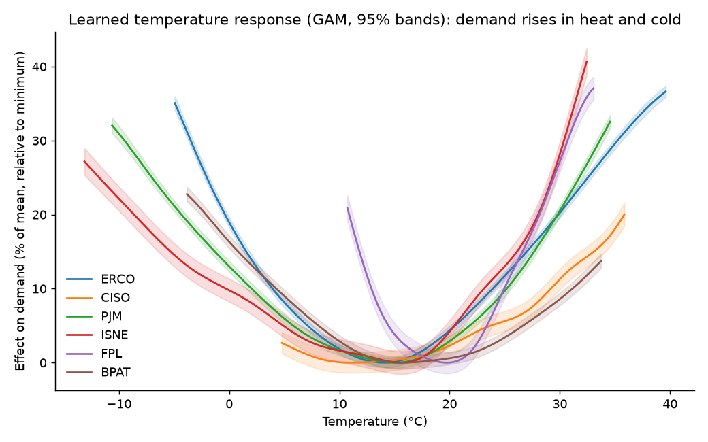
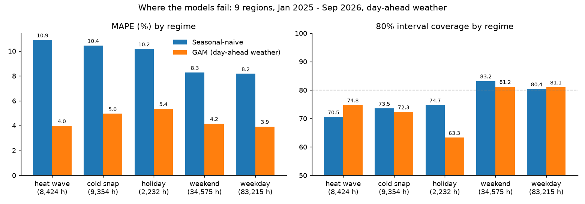
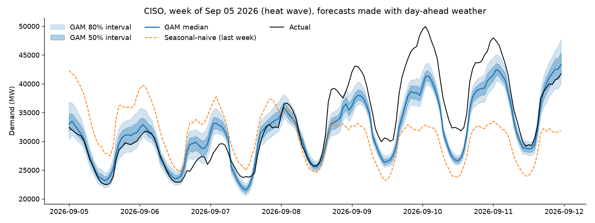
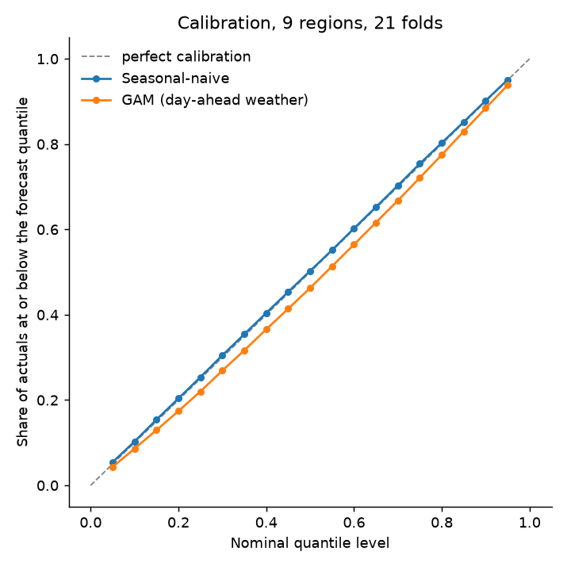

# Probabilistic Day-Ahead Electricity Demand Forecasting

Hourly, day-ahead demand forecasts with **calibrated 80% prediction intervals** for 10 US
balancing authorities, built on a Databricks (PySpark + Delta Lake) medallion pipeline and
evaluated with a leak-free 21-month walk-forward backtest.

**Headline:** a generalized additive model (GAM) using the weather forecast available the
day before cuts probabilistic error (CRPS) by **56% versus seasonal-naive**, more than halves MAPE
(**4.09% vs 8.55%**), keeps empirical 80% interval coverage at **79.8%**, and the
improvement is statistically significant in every region (Diebold-Mariano, Newey-West).



---

## Results

21 monthly walk-forward folds (test months Jan 2025 – Sep 2026), 153,112 scored hours.
Forecasts are made with **day-ahead forecast weather**, not observed weather (see
[Weather leakage](#weather-leakage-measured)).

| Region | CRPS naive (MW) | CRPS GAM (MW) | CRPS improvement | MAPE naive | MAPE GAM | 80% coverage naive | 80% coverage GAM | DM stat |
| --- | ---: | ---: | ---: | ---: | ---: | ---: | ---: | ---: |
| BPAT | 327 | 139 | 57% | 5.80% | 2.56% | 79.4% | 79.7% | 12.5 |
| CISO | 1,367 | 777 | 43% | 6.51% | 3.79% | 80.4% | 79.1% | 9.0 |
| ERCO | 3,543 | 1,414 | 60% | 8.19% | 3.21% | 80.7% | 79.7% | 11.0 |
| FPL | 1,251 | 633 | 49% | 9.96% | 5.14% | 79.6% | 80.5% | 12.0 |
| ISNE | 1,209 | 577 | 52% | 11.77% | 6.06% | 80.2% | 80.1% | 10.5 |
| MISO | 4,669 | 1,737 | 63% | 7.56% | 2.88% | 79.5% | 79.6% | 12.7 |
| NYIS | 1,314 | 577 | 56% | 9.44% | 4.47% | 81.1% | 79.8% | 10.2 |
| PJM | 7,020 | 3,008 | 57% | 8.90% | 3.87% | 80.1% | 79.6% | 11.5 |
| SWPP | 2,433 | 1,302 | 46% | 8.85% | 4.81% | 79.2% | 80.4% | 9.8 |
| **All 9 above** | **2,570** | **1,130** | **56%** | **8.55%** | **4.09%** | **79.9%** | **79.8%** | **16.3** |
| LDWP ⚠️ | 293 | 192 | 34% | 30.59% | 23.13% | 81.3% | 79.3% | 6.7 |

- **CRPS** (continuous ranked probability score) is the primary metric: it scores the whole
  predictive distribution, rewarding accuracy and sharpness together, and is a proper
  scoring rule. It is in MW, so compare models within a region, not regions with each other.
- **DM stat:** Diebold-Mariano test on hourly CRPS differences with a one-week Newey-West
  variance (hourly errors are strongly autocorrelated). |DM| > 1.96 is significant at 5%;
  every region is far beyond it (pooled p ≈ 10⁻⁵⁹).
- **LDWP** is reported separately: its published demand has long stretches pinned near
  175–250 MW against a ~2,500 MW median. That is a data-quality problem, not a hard region.

### Error by regime



| Regime (9 regions) | Hours | MAPE naive | MAPE GAM | CRPS improvement | 80% coverage GAM |
| --- | ---: | ---: | ---: | ---: | ---: |
| Heat wave day (region's hottest 5%) | 8,424 | 10.9% | 4.0% | 65% | 74.8% |
| Cold snap day (region's coldest 5%) | 9,354 | 10.5% | 5.0% | 54% | 72.3% |
| Major holiday | 2,232 | 10.2% | 5.4% | 53% | 63.3% |
| Weekend | 34,575 | 8.3% | 4.2% | 54% | 81.3% |
| Weekday | 83,215 | 8.2% | 3.9% | 56% | 81.1% |

The GAM more than halves error in every regime and gains most in heat waves (65%), exactly
where repeating last week fails. Cold snaps and holidays remain ~25–35% harder than ordinary
days, and **intervals are too narrow on extreme days and holidays** (63–75% coverage),
offset by slight over-coverage on normal days.

### A heat-wave week



Seasonal-naive repeats a mild week straight through California's September 2026 heat wave.
The GAM sees the heat coming and climbs with it, but still **under-forecasts the peaks**,
and actual demand breaks above the 80% interval on the hottest days.

### Calibration



Share of actuals at or below each of the 19 forecast quantiles. Seasonal-naive sits on the
diagonal; the GAM runs a few points below it at every level, a slight systematic
under-forecast (median bias ≈ +150 MW) that the heat-wave week also shows.

---

## Methodology

**Data.** Hourly demand from the EIA API v2 and hourly weather from Open-Meteo for 10
balancing authorities (CISO, ERCO, PJM, MISO, NYIS, ISNE, BPAT, SWPP, FPL, LDWP), January 2023
to present, ~331k region-hours. Everything is stored in UTC; local time is derived only for
calendar features.

**Pipeline (Databricks Free Edition, serverless Spark Connect, Delta Lake).**

```
EIA + Open-Meteo ──► bronze (raw, MERGE upserts keyed on region + hour: idempotent, revisions picked up)
                 ──► silver (complete UTC hourly grid, gaps flagged not filled, range checks)
                 ──► gold.features (local calendar, holidays, leak-free lags, Fourier terms,
                                    heating/cooling degree-hours) ──► backtest tables
```

Real data issues the pipeline surfaced and handles explicitly: EIA hours published with no
value and hours missing entirely (both flagged `has_gap`, never forward-filled); whole local
days missing for some utilities, several on DST transitions (e.g. PJM on 2024-03-10, blank at
the source); CISO and LDWP sharing a weather coordinate.

**Models.**

- *Seasonal-naive* (benchmark only): demand at the same hour one week earlier.
- *GAM* (pygam, one per region and fold): smooth terms for temperature, a cyclic 168-hour
  hour-of-week curve (weekday and weekend daily shapes differ), a cyclic seasonal curve, a
  major-holiday effect, 48h/168h demand lags, a **temperature × hour-of-day** surface
  (cooling load lands in the afternoon and evening), and a **trailing 24h mean temperature**
  (heat build-up). The last two cut CRPS 10% overall and heat-wave MAPE from 5.5% to 4.0%.

**Leak-free features.** The forecast is issued at 13:00 UTC (06:00 Pacific) for the next UTC
day, so target hours are 11–34h ahead. A 24h lag would point at hours that haven't happened
yet for most targets, so lags are 48h and 168h and every rolling window ends ≥48h back.

**Walk-forward backtest.** 21 monthly folds, expanding window, refit each month, 48h embargo
before each test month. Every model is scored on identical folds and emits 19 quantiles per
hour; CRPS is 2 × mean pinball loss across them.

**Calibrated intervals (normalized conformal prediction).**
`q_τ(t) = point forecast + σ(t) · z_τ(hour)`, where σ(t) is the mean absolute error over the
7 days ending 48h before t (known at issue time) and z_τ are quantiles of standardized
errors. For the GAM, z is learned on a held-out year and the model is then refit for the
forecast. Measured alternatives and why they lost: hour-stratified offsets (8.9-point mean
monthly coverage miss vs 2.4), month stratification (fails across years with the same
label), a 90-day calibration window (76% coverage, learned one season's error shape).

### Weather leakage, measured

Backtests that use *observed* weather are optimistic: at forecast time only a forecast
exists. Same GAM, three weather inputs at prediction time (9 regions):

| Prediction-time weather | CRPS | vs naive |
| --- | ---: | ---: |
| Observed (ERA5 reanalysis) | 1,225 | −52.3% |
| Open-Meteo "historical forecast" | 1,224 | −52.4% |
| **Forecast issued a day earlier** (Previous Runs API) | **1,275** | **−50.4%** |

Open-Meteo's historical-forecast product scores exactly like observed weather (it is
stitched from the start of each model run), so it cannot measure leakage. The day-earlier
forecast (MAE 1.5 °C against observations) is the honest input: weather-forecast error costs
about 4% CRPS. Its lead time (~24–47h) is slightly longer than this system's 11–34h, so if
anything it overstates that cost. *(Numbers in this table predate the final interval
calibration; the main table uses it.)*

---

## Limitations

- **Extreme peaks and holidays.** The GAM still under-forecasts the most extreme peaks
  (CISO, 10 Sep 2026: ~41 GW forecast vs 50 GW actual), and intervals cover 63–75% on
  extreme-weather days and holidays. The 7-day volatility scale lags the onset of extremes.
- **One weather point per region.** MISO spans Minnesota to Louisiana; one Indianapolis
  temperature is a crude proxy. FPL cold snaps (rare in training) and holidays are the worst
  cells.
- **CISO improves least (43%).** Its error peaks at 5 PM, when behind-the-meter solar
  collapses and depends on cloud cover, which no current feature captures.
- **June coverage** (74–76%) is the weakest month: early-summer heat outruns the volatility scale.
- **LDWP data quality** limits any model there; excluded from headline averages.
- **Weather-forecast lead time** is approximated (day-earlier forecast, ~24–47h).
- **Not yet built:** the hierarchical Bayesian model for the CAISO sub-areas with MinT
  reconciliation, the live API, and drift monitoring (in progress).
- **Fleet job on Databricks:** `databricks/04_train_fleet.py` fits all region-folds with
  `applyInPandas`, but Python UDFs fail to start from Databricks Connect on this Free Edition
  workspace (`ISOLATION_STARTUP_FAILURE`). The reported results come from the local harness,
  which runs the identical `models/` code.

## Next steps

Ranked by expected impact on the weakest results:

1. Intervals conditioned on forecast temperature extremity and holidays, not only recent
   volatility (fixes the 63–75% regime coverage).
2. Solar radiation / cloud cover (CISO's 5 PM error), and multi-point population-weighted
   weather for large regions.
3. Days-around-holiday effects (Christmas Eve, the days between Christmas and New Year).

---

## Repository

```
ingest/      EIA and Open-Meteo clients, UTC/DST handling, holiday calendars (pure Python, tested)
databricks/  01-03 bronze/silver/gold pipeline, 04 GAM fleet job, 06 Spark backtest, eda_*
models/      model code shared by local and Spark runs: scoring, intervals, naive, GAM
scripts/     export_gold (snapshot to Parquet), backtest_local, dm_test, regime_analysis,
             make_figures, eda_gam_coverage
tests/       pytest suite (DST transitions, gaps, clients, calendars)
docs/figures README plots
```

### Reproduce

```bash
python -m venv .venv && .\.venv\Scripts\Activate.ps1      # Python 3.12
pip install -e ".[pipeline,modeling,dev]"
# set EIA_API_KEY in .env; Databricks auth via ~/.databrickscfg
python databricks/01_bronze_ingest.py
python databricks/01_bronze_weather.py
python databricks/02_silver_clean.py
python databricks/02_silver_weather.py
python databricks/03_gold_features.py
python databricks/06_backtest.py          # seasonal-naive on Spark, defines the folds
python scripts/export_gold.py             # snapshot to data/ for local modeling
python scripts/backtest_local.py --models seasonal_naive gam_fcst
python scripts/dm_test.py && python scripts/regime_analysis.py && python scripts/make_figures.py
```
